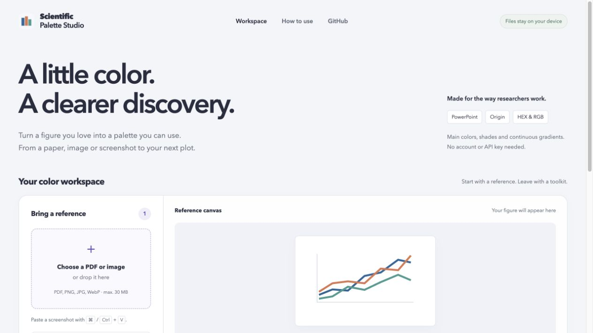
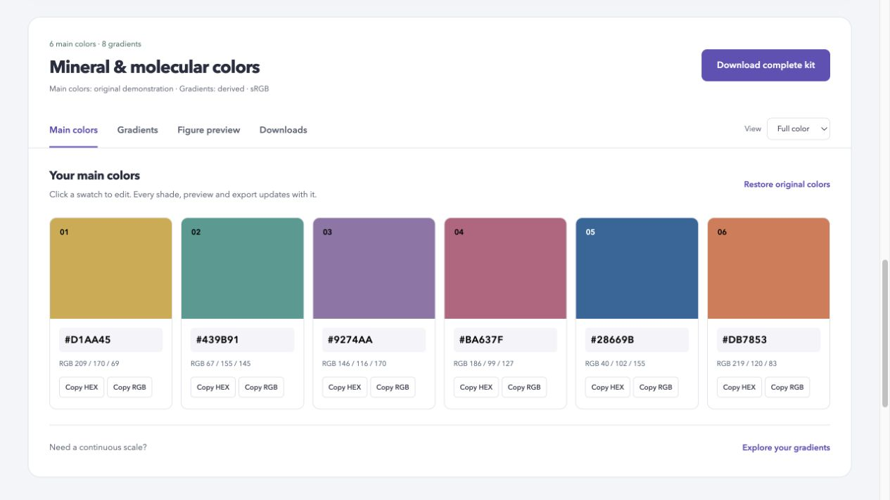
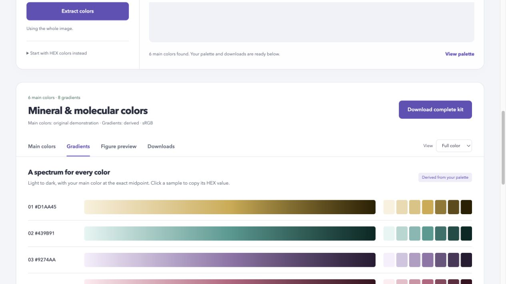
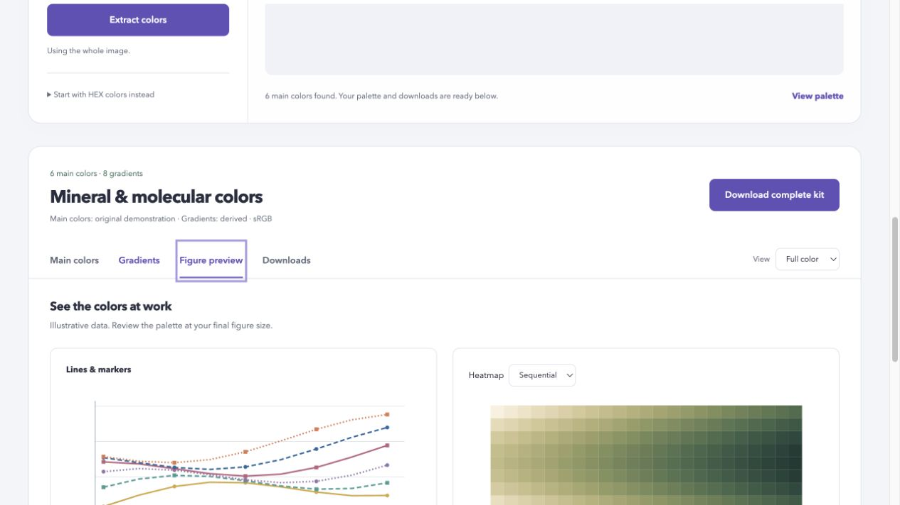
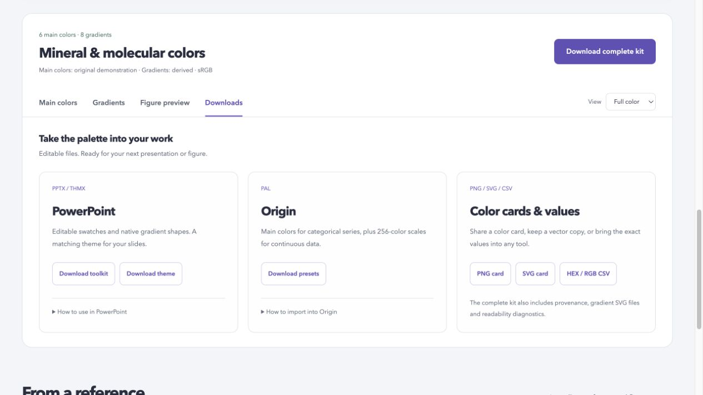
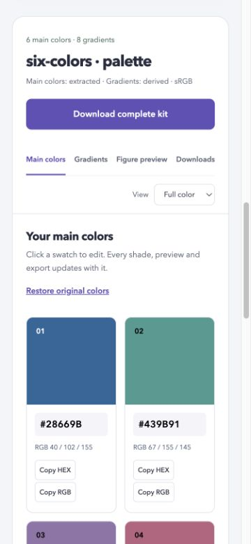
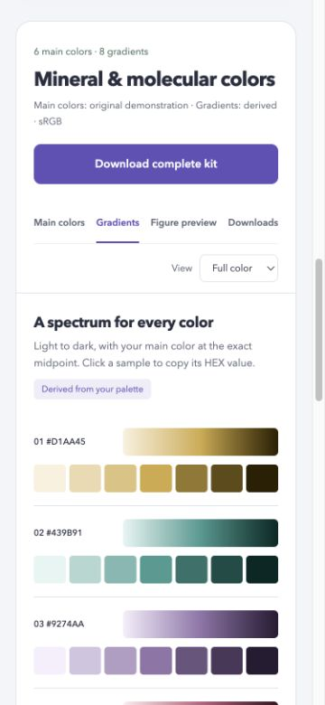

# UI review — 2026-10-11

The review covered reference selection, extraction, editing, gradients, figure previews and downloads. The original page mixed eight competing actions and stacked all results into a long document. The revised interface gives the reference canvas and live colors priority, groups exports by destination, and uses four keyboard-accessible result tabs.

## 1. Reference and extraction — verified

PDF/image upload and the labeled original example are clear starting points. Six known colors were extracted exactly from PNG and from colored page 2 of a two-page PDF. A crop selected two colors without synthesizing additional hues. Processing feedback remains visible. Source files remain browser-local.

## 2. Main colors — verified

A single complete-kit action replaces the competing download row. Main colors are larger, with editable HEX values and RGB values. A typed `#AA3344` edit propagated to the first gradient midpoint, theme accents, native PPT fills and Origin RGB records. A new source opens Main colors; editing or changing the grayscale preview preserves the selected tab.

## 3. Gradients — verified

Tonal scales and discrete samples are aligned. Sequential and diverging scales remain available, with direct PAL/SVG downloads. Main colors and derived gradients remain explicitly distinguished. Mobile samples occupy a complete row to give each color a larger touch target.

## 4. Figure previews — verified

Line/marker and heatmap previews share the live palette. Readability notes are expandable rather than competing with the main task. Tabs passed click, ArrowRight and End navigation. Selected state, visible focus and linked tab panels were inspected. Continuous-scale controls now support Enter/Space activation.

## 5. Downloads — verified at the package level

Exports are grouped into PowerPoint, Origin, and color cards/values. Use instructions sit beside their destination. A downloaded edited kit passed ZIP CRC checks, PNG decoding, parsing of 48 native XML/relationship files, theme accent checks and categorical PAL value checks. This is package verification; a native Origin/PowerPoint application session was not exercised.

## 6. Responsive reflow — verified at tested breakpoints

Requested widths of 375 and 820 pixels had equal document client and scroll widths (360/360 and 805/805 with the browser scrollbar). Main colors, gradients and download groups were visually checked on mobile. Temporary viewport overrides were reset.

## Limits

Screenshots do not establish full accessibility compliance. Keyboard tabs, focus indicators, explicit labels and responsive reflow were inspected; screen-reader behavior and color-vision deficiency simulation were not evaluated. The diagnostic thresholds remain heuristics. Clipboard paste code was unchanged, and the system clipboard was not modified for this review.
